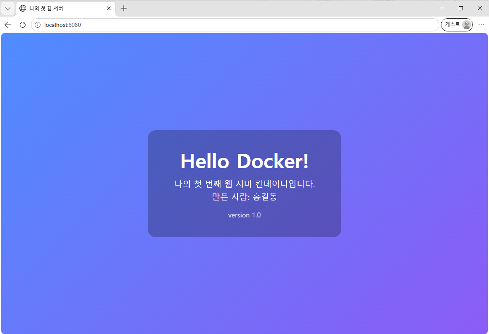
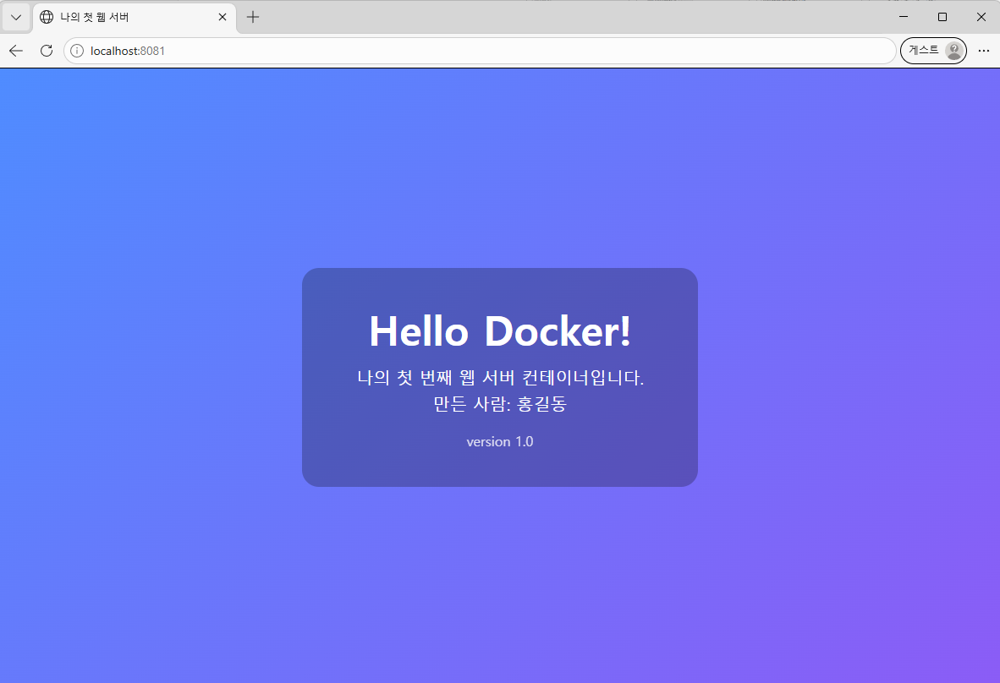
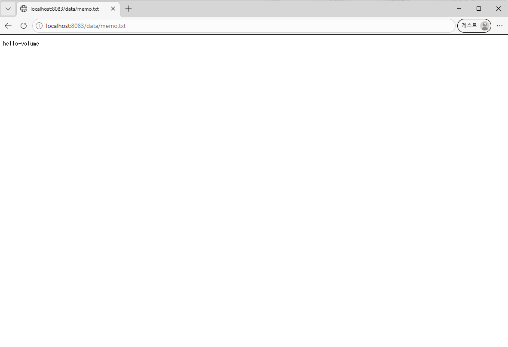
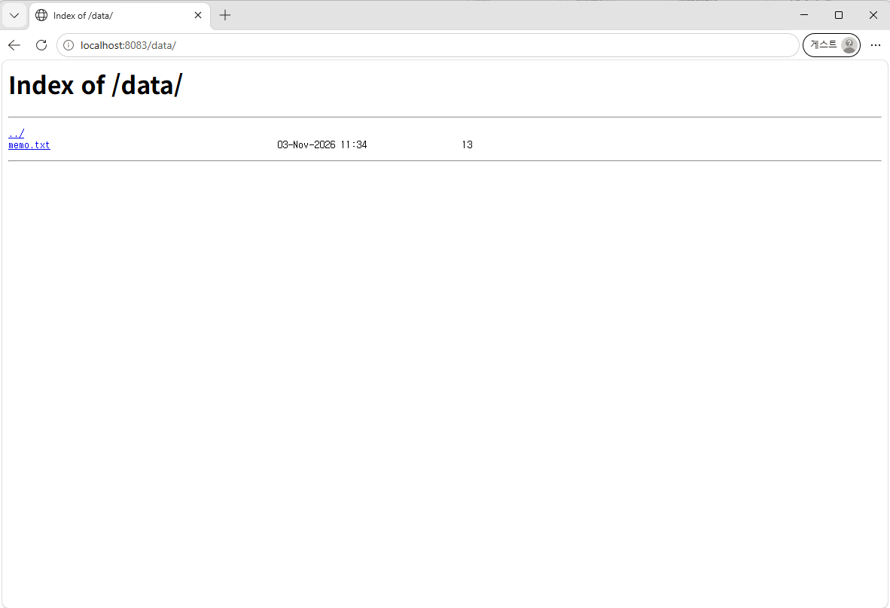
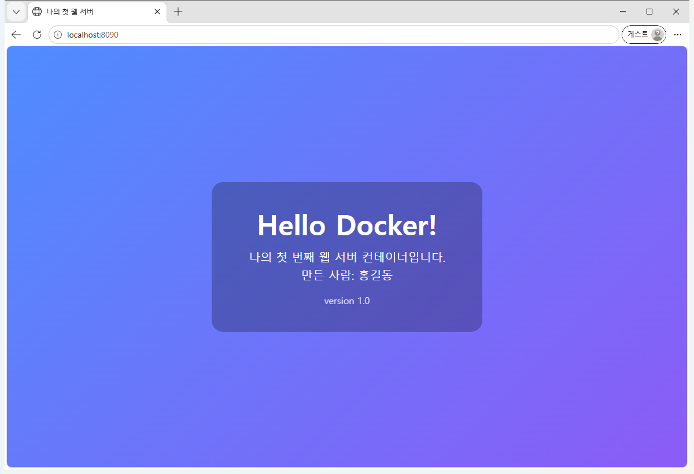
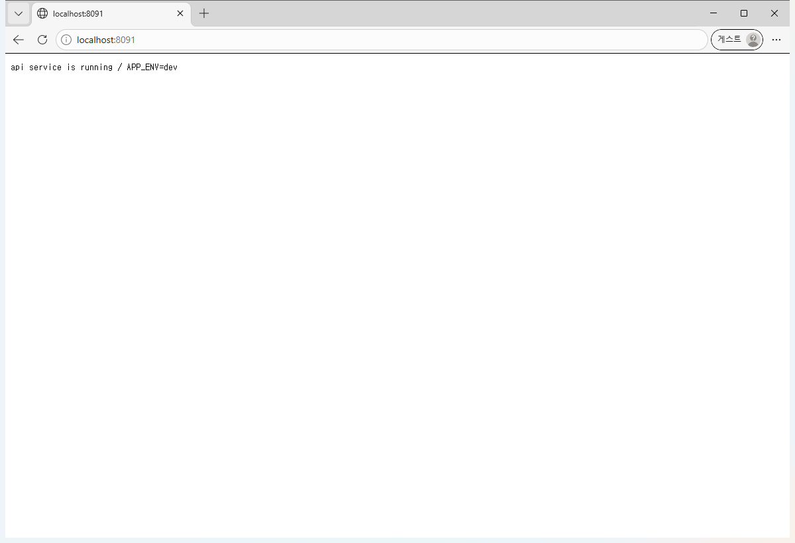

# 개발 워크스테이션 구축 미션

VS Code 터미널(**bash**)만으로 **터미널 조작 → 권한 → Docker → 커스텀 이미지 → 포트 매핑 → 바인드 마운트 → 볼륨 → Git/GitHub** 전 과정을 수행하고, 명령과 출력을 그대로 기록한 저장소입니다.

> **한눈에 보기**
> - 만든 것 : 공식 `nginx` 를 바탕으로 **내가 고친 커스텀 이미지** `my-web-server:1.0`
> - 확인한 것 : 포트 **8080 / 8081** 접속 성공, 바인드 마운트 **8082** 실시간 반영, 볼륨 **8083** 삭제 후에도 데이터 유지
> - 보너스 : **Docker Compose** 로 `web`+`api` 두 개를 한 줄에 띄우고, **환경 변수**로 응답을 바꿔 봤습니다 (8090 / 8091)
> - 증거 위치 : [`evidence/`](evidence/) 폴더 (명령 + 출력이 **한 쌍으로** 들어 있습니다)
> - 따라하기 : [`commands/`](commands/) 폴더의 텍스트 파일을 **복사해 붙여넣기만** 하면 됩니다

---

## 1) 실행 환경

| 항목 | 값 | 확인 명령 |
|---|---|---|
| OS | Windows 11 Pro (build 26200) | `cmd.exe //c ver` |
| 쉘 | **bash 5.3.9** (Git Bash / MINGW64) | `echo $BASH_VERSION` |
| 터미널 | **VS Code 통합 터미널** — 프로필 `Git Bash` | `uname -a` |
| Docker | **29.9.2** (build a82e528) / Docker Desktop 4.97.0 | `docker --version` |
| Docker Compose | v5.6.1 | `docker compose version` |
| 컨테이너 엔진 | WSL2 backend · Linux 6.18.54.1-microsoft-standard-WSL2 | `docker info` |
| Git | **2.54.0.windows.1** | `git --version` |
| 에디터 | Visual Studio Code | `code --version` |
| 웹 서버 | nginx 1.31.8 (`nginx:latest` 기반) | `curl -I http://localhost:8080/` |

> **PowerShell 이 아니라 bash 를 쓴 이유** — 과제의 결과 예시가 `Shell: bash` 기준이고,
> 같은 명령이 리눅스·맥에서도 그대로 동작해 재현성이 높기 때문입니다.
> 윈도우에서는 Git for Windows 에 들어 있는 **Git Bash** 를 VS Code 터미널 프로필로 선택해 사용했습니다.

전체 출력 → [`evidence/01-environment.md`](evidence/01-environment.md)

---

## 2) 수행 체크리스트

과제의 **기능 요구사항 11개** 기준입니다. 모두 이 PC에서 실제로 실행해 출력을 확인했습니다.

| # | 요구사항 | 완료 | 증거 | 따라하기 |
|---|---|---|---|---|
| 1 | 제출 저장소 및 기술 문서 | [x] | 이 README | — |
| 2 | 터미널 조작 로그 (위치/목록(숨김)/이동/생성/복사/이름변경/삭제/내용확인/빈 파일) | [x] | [02-terminal.md](evidence/02-terminal.md) | [02-terminal.txt](commands/02-terminal.txt) |
| 3 | 권한 실습 (파일 1개 + 디렉토리 1개, 변경 전/후) | [x] | [03-permission.md](evidence/03-permission.md) | [03-permission.txt](commands/03-permission.txt) |
| 4 | Docker 설치 및 기본 점검 (`--version`, `info`) | [x] | [04-docker-check.md](evidence/04-docker-check.md) | [04-docker-check.txt](commands/04-docker-check.txt) |
| 5 | Docker 기본 운영 명령 (`images`/`ps`/`ps -a`/`logs`/`stats`) | [x] | [05-docker-ops.md](evidence/05-docker-ops.md) | [05-docker-ops.txt](commands/05-docker-ops.txt) |
| 6 | 컨테이너 실행 실습 (hello-world, ubuntu 내부 `ls`/`echo`, exec vs attach) | [x] | [06-container-lab.md](evidence/06-container-lab.md) | [06-container-lab.txt](commands/06-container-lab.txt) |
| 7 | 기존 Dockerfile 기반 **커스텀 이미지** 제작 | [x] | [07-custom-image.md](evidence/07-custom-image.md) · [Dockerfile](Dockerfile) | [07-custom-image.txt](commands/07-custom-image.txt) |
| 8 | 포트 매핑 및 접속 증거 (서로 다른 포트 2개) | [x] | [08-port-mapping.md](evidence/08-port-mapping.md) · [화면](#8-포트-매핑-접속-증거) | [08-port-mapping.txt](commands/08-port-mapping.txt) |
| 9 | Docker 볼륨 영속성 검증 (삭제 전/후) | [x] | [10-volume.md](evidence/10-volume.md) | [10-volume.txt](commands/10-volume.txt) |
| 10 | Git 설정 및 GitHub 연동 (`git config --list`) | [x] | [11-git-github.md](evidence/11-git-github.md) | [11-git-github.txt](commands/11-git-github.txt) |
| 11 | 보안 및 개인정보 보호 (마스킹) | [x] | [아래 14절](#14-보안과-개인정보-보호) | — |
| ＋ | 바인드 마운트 반영 (호스트 변경 전/후) | [x] | [09-bind-mount.md](evidence/09-bind-mount.md) | [09-bind-mount.txt](commands/09-bind-mount.txt) |
| ＋ | (보너스) Docker Compose · 멀티 컨테이너 · 환경 변수 | [x] | [12-compose.md](evidence/12-compose.md) | [12-compose.txt](commands/12-compose.txt) |
| ＋ | (보너스) GitHub SSH 키 설정 — 절차 정리 | [아래 12절](#12-보너스-과제-docker-compose--환경-변수--ssh-키) | [13-ssh.md](evidence/13-ssh.md) | [13-ssh.txt](commands/13-ssh.txt) |

---

## 3) 폴더 구조

```text
dev-workstation-mission/
├── app/
│   └── index.html              # 웹 서버 소스코드 (커스텀 콘텐츠)
├── config/
│   ├── default.conf            # 교체한 nginx 설정 (커스텀 포인트)
│   └── api.conf.template       # (보너스) 환경 변수가 들어가는 nginx 템플릿
├── labs/
│   └── permission-lab.sh       # 리눅스 권한 실습 스크립트
├── commands/                   # ★ VS Code 터미널에 복사해 붙여넣는 명령 모음
│   ├── 00-README.txt
│   └── 01-environment.txt ~ 13-ssh.txt, 99-cleanup.txt
├── evidence/                   # ★ 실제 실행한 명령 + 출력
│   ├── 01-environment.md ~ 13-ssh.md
│   └── images/                 # 주소창이 보이는 브라우저 캡처
├── Dockerfile
├── docker-compose.yml          # (보너스) 여러 컨테이너 설계도
├── .env.example                # (보너스) 환경 변수 예시 (.env 는 올리지 않음)
├── .dockerignore / .gitignore / .gitattributes
└── README.md
```

---

## 4) 따라 하는 방법 (VS Code + bash 기준)

```text
1. VS Code 실행 → 파일 → 폴더 열기 → 이 저장소 폴더 선택
2. 메뉴 [터미널] → [새 터미널]                     (단축키 : Ctrl + ` )
3. 터미널 패널 오른쪽 위 [v] → 'Git Bash' 선택     ← ★ PowerShell 이 아니라 bash
   프롬프트가  사용자@PC MINGW64 /d/... $  처럼 '$' 로 끝나면 성공
4. commands/ 폴더의 파일을 01번부터 순서대로 열고
   안에 있는 명령을 한 줄씩 복사 → 터미널에 붙여넣기 → Enter
```

항상 bash 로 열리게 하려면 `Ctrl + Shift + P` → **Terminal: Select Default Profile** → **Git Bash**.
`#` 으로 시작하는 줄은 설명이라 같이 복사해도 실행되지 않습니다.

> **★ 윈도우 bash 에서 꼭 먼저 칠 한 줄**
> ```bash
> export MSYS_NO_PATHCONV=1
> ```
> Git Bash 는 `/usr/share/nginx/html` 같이 `/` 로 시작하는 글자를 윈도우 경로로 자동 변환합니다.
> 이 한 줄을 먼저 실행하지 않으면 `docker` 의 컨테이너 내부 경로가 `C:/Program Files/Git/usr/...` 로
> 바뀌어 실패합니다. 맥·리눅스에서는 필요 없고, 실행해도 아무 문제가 없습니다.

평가자가 처음부터 재현하려면 아래 다섯 줄이면 충분합니다.

```bash
git clone https://github.com/sorryhjlee-afk/dev-workstation-mission.git
cd dev-workstation-mission
export MSYS_NO_PATHCONV=1          # 윈도우 Git Bash 에서만
docker build -t my-web-server:1.0 .
docker run -d -p 8080:80 --name web-8080 my-web-server:1.0
```

> **경로에 대하여** — 이 문서의 명령은 모두 **저장소 폴더 안에서** 실행합니다.
> `$(pwd)` 는 "지금 있는 폴더"를 뜻하므로 저장소를 어디에 내려받아도 그대로 동작합니다.
> 특정 PC 경로(`C:\...`)에 의존하는 명령은 사용하지 않았습니다.

---

## 5) 수행 로그 (발췌)

전체 로그는 [`evidence/`](evidence/) 에 있습니다. 아래는 핵심만 뽑은 것입니다.

### 5-1. 터미널 조작

```text
$ pwd
/d/22.코드아카데미/dev-workstation-mission

$ touch empty.txt && ls -l empty.txt
-rw-r--r-- 1 lovehjlee 197121 0 Nov  3 22:59 empty.txt

$ echo "hello docker" > hello.txt && cat hello.txt
hello docker

$ cp hello.txt copy.txt && mv copy.txt renamed.txt
$ mkdir -p sub && mv renamed.txt ./sub/ && ls -R
.:
empty.txt
hello.txt
sub

./sub:
renamed.txt
```

### 5-2. 권한 변경 전 / 후 (리눅스)

```text
=== (1) 변경 전 권한 ===
run-demo.sh = 644 (-rw-r--r--)
mydir = 755 (drwxr-xr-x)

=== (2) 실행 권한이 없는 스크립트를 실행하면? ===
/labs/permission-lab.sh: line 19: ./run-demo.sh: Permission denied
exit-code=126

=== (3) 권한 변경 : 파일 644 -> 755 , 디렉토리 755 -> 700 ===
run-demo.sh = 755 (-rwxr-xr-x)
mydir = 700 (drwx------)

=== (4) 변경 후 : 같은 스크립트가 이제 실행된다 ===
permission-ok
exit-code=0

=== (5) 디렉토리 700 의 의미 : 다른 사용자는 못 들어간다 ===
ls: cannot open directory '/lab/mydir': Permission denied
exit-code=2
```

### 5-3. 컨테이너 실행 / exec vs attach

```text
$ docker run --rm hello-world
Hello from Docker!
This message shows that your installation appears to be working correctly.

$ docker exec lab-ubuntu bash -c 'echo hello-from-container; head -2 /etc/os-release'
hello-from-container
PRETTY_NAME="Ubuntu 24.04.5 LTS"
NAME="Ubuntu"

$ docker attach --no-stdin lab-attach
main-process-finished

$ docker ps -a --filter name=lab-attach --format "{{.Names}} / {{.Status}}"
lab-attach / Exited (0) 1 second ago        ← attach 는 주 프로세스가 끝나면 컨테이너도 멈춘다

$ docker ps -a --filter name=lab-ubuntu --format "{{.Names}} / {{.Status}}"
lab-ubuntu / Up 20 seconds                  ← exec 만 쓴 컨테이너는 계속 살아 있다
```

### 5-4. 빌드와 운영 명령

```text
$ docker build -t my-web-server:1.0 .
#6 [3/3] COPY app/ /usr/share/nginx/html/
#7 naming to docker.io/library/my-web-server:1.0 done

$ docker images my-web-server
IMAGE                 ID             DISK USAGE   CONTENT SIZE
my-web-server:1.0     ...                 241MB         63.9MB

$ docker stats --no-stream ops-demo
CONTAINER ID   NAME       CPU %   MEM USAGE / LIMIT     MEM %   PIDS
...            ops-demo   0.00%   13.9MiB / 15.18GiB    0.09%   17
```

---

## 6) Dockerfile 선택과 커스텀 포인트

**선택한 방식 : (A) 웹 서버 베이스 이미지 활용** — 공식 `nginx:latest` 를 바탕으로 삼고
정적 콘텐츠와 설정을 내 것으로 교체했습니다. (언어 런타임이 필요 없는 가장 단순한 구성)

```dockerfile
FROM nginx:latest                                    # 바탕 이미지
LABEL org.opencontainers.image.title="my-web-server" # 이름표
ENV APP_ENV=dev                                      # 커스텀 ①
COPY config/default.conf /etc/nginx/conf.d/default.conf   # 커스텀 ②
COPY app/ /usr/share/nginx/html/                     # 커스텀 ③
EXPOSE 80
CMD ["nginx", "-g", "daemon off;"]
```

| 커스텀 포인트 | 목적 | 확인 방법 |
|---|---|---|
| ① `ENV APP_ENV=dev` | 개발용 환경이라는 표시를 환경 변수로 넣는다 | `docker exec web-8080 printenv APP_ENV` → `dev` |
| ② nginx 설정 교체 | 응답 헤더 `X-Mission` 추가, `/data/` 목록 보기 허용 | 응답 헤더에 `X-Mission: codyssey-m1` |
| ③ 정적 콘텐츠 교체 | 기본 안내 페이지를 내가 만든 한국어 페이지로 | 브라우저 화면 |

빌드·확인 출력 → [`evidence/07-custom-image.md`](evidence/07-custom-image.md)

```text
$ docker image inspect my-web-server:1.0 --format "Env={{.Config.Env}}"
Env=[PATH=... NGINX_VERSION=1.31.8 ... APP_ENV=dev]
```

---

## 7) 포트 매핑이 필요한 이유

컨테이너는 **자기만의 네트워크**를 가집니다. 컨테이너 안의 nginx 는 언제나 **80번**을 쓰는데,
내 컴퓨터의 80번은 하나뿐이라 여러 개를 동시에 띄울 수 없습니다.
그래서 **바깥쪽(호스트) 번호만 다르게** 주고 안쪽 80번으로 연결합니다.

```text
브라우저 → 내 컴퓨터 8080 ─┐
                           ├→ (같은 이미지로 만든 서로 다른 컨테이너) → 각자의 80번 → index.html
브라우저 → 내 컴퓨터 8081 ─┘
```

---

## 8) 포트 매핑 접속 증거

```text
$ docker ps
NAMES       STATUS         PORTS
web-8080    Up 2 seconds   0.0.0.0:8080->80/tcp, [::]:8080->80/tcp
web-8081    Up 1 second    0.0.0.0:8081->80/tcp, [::]:8081->80/tcp

$ curl -s -D - -o /dev/null http://localhost:8080/
HTTP/1.1 200 OK
Server: nginx/1.31.8
Content-Length: 995
X-Mission: codyssey-m1          ← 내가 교체한 nginx 설정이 적용된 증거

$ curl -s -o /dev/null -w "%{http_code}\n" http://localhost:8080/no-such-page
404
```

**브라우저 접속 화면 (주소창 + 포트 + 응답 화면)**

| 호스트 포트 8080 | 호스트 포트 8081 |
|---|---|
|  |  |

전체 로그 → [`evidence/08-port-mapping.md`](evidence/08-port-mapping.md)

---

## 9) 바인드 마운트 (호스트 변경 전 / 후)

**바인드 마운트** = 내 컴퓨터 폴더를 컨테이너 안에 그대로 겹쳐 놓는 것.
컨테이너가 내 폴더를 **실시간으로** 보기 때문에 다시 빌드하지 않아도 반영됩니다.

```bash
export MSYS_NO_PATHCONV=1          # 윈도우 Git Bash 에서만
docker run -d -p 8082:80 --name bind-8082 -v "$(pwd)/app:/usr/share/nginx/html" my-web-server:1.0
```

```text
① 변경 전   8082 <h1>Hello Docker!</h1>        version 1.0
② 호스트의 app/index.html 을 수정 (빌드는 하지 않음)
③ 변경 후   8082 <h1>안녕하세요, 도커!</h1>     version 2.0 (수정됨)
④ 같은 순간 8080 <h1>Hello Docker!</h1>        version 1.0   ← COPY 로 구운 쪽은 그대로
```

같은 이미지인데 결과가 다릅니다. **8082 는 내 폴더를 실시간으로 보고, 8080 은 빌드할 때 복사해 둔 사본을 봅니다.**
전체 로그 → [`evidence/09-bind-mount.md`](evidence/09-bind-mount.md)

---

## 10) 볼륨 영속성 (컨테이너 삭제 전 / 후)

컨테이너는 지우면 안의 내용도 사라집니다. 지켜야 할 자료는 **볼륨**에 넣습니다.

```text
$ docker volume create my-data
$ docker run -d -p 8083:80 --name vol-8083 -v my-data:/usr/share/nginx/html/data my-web-server:1.0
$ docker exec vol-8083 sh -c 'echo hello-volume > /usr/share/nginx/html/data/memo.txt'
$ curl -s http://localhost:8083/data/memo.txt
hello-volume

$ docker rm -f vol-8083                       ← ★ 컨테이너를 통째로 삭제
$ docker ps -a --filter name=vol-8083
CONTAINER ID   IMAGE   COMMAND   CREATED   STATUS   PORTS   NAMES
                                                            ← 비어 있음 (완전히 사라짐)

$ docker volume ls --filter name=my-data
DRIVER    VOLUME NAME
local     my-data                             ← 볼륨은 남아 있음

$ docker run -d -p 8083:80 --name vol-8083-new -v my-data:/usr/share/nginx/html/data my-web-server:1.0
$ docker exec vol-8083-new cat /usr/share/nginx/html/data/memo.txt
hello-volume                                  ← 데이터 유지 확인
```

| 삭제 후 새 컨테이너에서 본 화면 | 볼륨 폴더 목록 |
|---|---|
|  |  |

전체 로그 → [`evidence/10-volume.md`](evidence/10-volume.md)

---

## 11) Git 설정 및 GitHub 연동

```text
$ git config --list
user.name=sorryhjlee-afk
user.email=289445261+sorryhjlee-afk@users.noreply.github.com
init.defaultbranch=main
remote.origin.url=https://github.com/sorryhjlee-afk/dev-workstation-mission.git

$ git branch --show-current
main
```

- 이메일은 GitHub 가 제공하는 **noreply 주소**를 사용해 실제 메일 주소가 공개되지 않습니다.
- VS Code 연동 : 왼쪽 아래 계정 아이콘 → **Sign in with GitHub** → 소스 제어 패널에서 커밋/동기화.
- 전체 로그 → [`evidence/11-git-github.md`](evidence/11-git-github.md)

---

## 12) 보너스 과제 (Docker Compose · 환경 변수 · SSH 키)

| 보너스 항목 | 결과 |
|---|---|
| Compose 기초 — `docker-compose.yml` 작성 후 `up -d` 한 줄로 실행 | 수행 |
| 멀티 컨테이너 — `web`(8090) + `api`(8091) 를 **동시에** 실행 | 수행 |
| Compose 운영 명령 — `build`/`up`/`ps`/`logs`/`top`/`stop`/`start`/`down` | 수행 |
| 환경 변수 활용 — `.env` + `${APP_ENV:-dev}` 로 응답까지 변경 | 수행 |
| GitHub SSH 키 설정 | **절차 정리** (계정 설정 변경이라 계정 주인이 직접 수행) |

전체 로그 → [`evidence/12-compose.md`](evidence/12-compose.md) · [`evidence/13-ssh.md`](evidence/13-ssh.md)

### 설계도 한 장으로 두 개를 한 번에

```text
$ docker compose up -d
 Network codyssey-bonus_default  Created
 Container compose-api           Created
 Container compose-web           Created
 Container compose-api           Started
 Container compose-web           Started

$ docker compose ps
NAME          IMAGE                   SERVICE   STATUS                  PORTS
compose-api   nginx:latest            api       Up Less than a second   0.0.0.0:8091->80/tcp
compose-web   my-web-server:compose   web       Up Less than a second   0.0.0.0:8090->80/tcp
```

`docker run` 을 두 번 길게 치는 대신 **한 줄**로 끝납니다. 끌 때도 `docker compose down` 한 줄입니다.

### 컨테이너끼리 '서비스 이름' 으로 서로를 찾는다

```text
$ docker network ls --filter name=codyssey-bonus
NETWORK ID     NAME                     DRIVER    SCOPE
2fa8f808e3be   codyssey-bonus_default   bridge    local

$ docker compose exec web getent hosts api
172.18.0.2      api

$ docker compose exec api getent hosts web
172.18.0.3      web
```

Compose 가 전용 네트워크를 자동으로 만들어 주기 때문에 **IP 주소를 몰라도** 서로를 부를 수 있습니다.

### 환경 변수가 응답까지 바꾼다

`docker-compose.yml` 에 `APP_ENV: ${APP_ENV:-dev}` 라고 적었습니다.
"`.env` 에 값이 있으면 그 값, 없으면 `dev`" 라는 뜻입니다.

```text
$ curl -s http://localhost:8091/
api service is running / APP_ENV=dev

$ sed -i 's/^APP_ENV=.*/APP_ENV=stage/' .env
$ docker compose up -d
 Container compose-api Recreated
 Container compose-web Recreated
 Container compose-api Started
 Container compose-web Started

$ curl -s http://localhost:8091/
api service is running / APP_ENV=stage
```

`.env` 는 사람마다 값이 다를 수 있고 비밀 값이 들어가기도 해서 **깃허브에 올리지 않습니다**
(`.gitignore` 로 차단). 대신 비밀이 없는 [`.env.example`](.env.example) 만 올려 두었습니다.

### down 해도 볼륨은 남는다

```text
$ docker compose down
 Container compose-web            Removed
 Container compose-api            Removed
 Network codyssey-bonus_default   Removed

$ docker volume ls --filter name=codyssey-bonus
DRIVER    VOLUME NAME
local     codyssey-bonus_web-data

$ docker compose up -d
$ docker compose exec web cat /usr/share/nginx/html/data/memo.txt
hello-compose-volume
```

### 브라우저 접속 증거 (주소창 + 응답 화면)

| web 서비스 — `localhost:8090` | api 서비스 — `localhost:8091` |
|---|---|
|  |  |

### GitHub SSH 키는 절차만 정리한 이유

SSH 키 등록은 ① **개인키(비밀 열쇠)를 새로 만들고** ② **깃허브 계정 설정을 바꾸는** 작업입니다.
과제의 보안 요구사항("민감한 개인 정보가 포함되지 않도록 한다")에 맞추기 위해,
개인키를 만들거나 계정 설정을 대신 바꾸지 않고 **따라 할 수 있는 절차와 마스킹한 예시 출력**으로 남겼습니다.
실제로 확인해 보면 지금 로그인된 GitHub CLI 에는 키를 등록할 권한 자체가 없습니다.

```text
$ ssh -V
OpenSSH_for_Windows_9.5p2, LibreSSL 3.8.2

$ gh ssh-key list
This API operation needs the "admin:public_key" scope.
```

절차 전체 → [`commands/13-ssh.txt`](commands/13-ssh.txt) · [`evidence/13-ssh.md`](evidence/13-ssh.md)

---

## 13) 트러블슈팅

### ① Docker Desktop 은 깔렸는데 엔진이 안 뜬다
- **문제** : `Error response from daemon: Docker Desktop is unable to start`
- **원인 가설** : Docker 는 리눅스 엔진 위에서 도는데 **WSL2 가 설치되지 않음**
- **확인** : `wsl --version` → "Linux용 Windows 하위 시스템이 설치되어 있지 않습니다"
- **해결** : 관리자 권한 PowerShell 에서 `wsl --install --no-distribution` → **재부팅** → `docker info` 로 `ServerVersion` 확인 (WSL 설치는 윈도우 기능이라 이 한 줄만 PowerShell)

### ② 호스트 포트 충돌
- **문제** : `Bind for 0.0.0.0:8080 failed: port is already allocated`
- **원인 가설** : 8080 번을 이미 다른 컨테이너가 점유
- **확인** : `docker ps` → PORTS 열에 `0.0.0.0:8080->80/tcp`
- **해결/대안** : 비어 있는 번호로 바꾸거나(`-p 8081:80`), 쓰던 컨테이너를 `docker stop` 으로 내린다

### ③ 컨테이너 이름 중복
- **문제** : `Conflict. The container name "/web-8080" is already in use`
- **원인 가설** : 정지 상태여도 이름은 계속 점유된다
- **확인** : `docker ps -a` 에 같은 이름이 남아 있음
- **해결** : `docker rm -f web-8080` 후 다시 실행

### ④ bash 에 따옴표가 섞인 명령을 넘기면 깨진다
- **문제** : `docker exec ... bash -c "... stat -c '%n %a' ..."` 실행 시 `unexpected EOF` / `syntax error near unexpected token '('`
- **원인 가설** : 쉘 → docker → 컨테이너 안 bash 로 넘어가며 따옴표와 괄호가 두 번 해석된다
- **확인** : 같은 명령을 짧게 줄여 보니 괄호가 포함된 구간에서만 실패
- **해결** : 명령을 **`labs/permission-lab.sh` 파일로 분리**하고 `docker run --rm -v "$(pwd)/labs:/labs" ubuntu:24.04 bash /labs/permission-lab.sh` 로 실행. 따옴표 중첩이 사라져 문제가 없어졌고, 다른 사람도 같은 스크립트로 재현할 수 있게 되었다.

### ⑤ 응답 헤더에서 커스텀 설정이 안 보인다
- **문제** : `curl ... | Select-Object -First 8` 결과에 `X-Mission` 헤더가 없음
- **원인 가설** : 설정이 적용되지 않았거나, 출력이 잘렸거나 둘 중 하나
- **확인** : `curl -I` 로 전체 헤더를 보니 `X-Mission` 은 **9번째 줄**, `docker exec web-8080 cat /etc/nginx/conf.d/default.conf` 로 설정도 정상 적용 확인
- **해결** : 앞 8줄만 자르던 것을 없애고 전체 헤더를 기록하도록 수정 (설정은 처음부터 정상이었음)

### ⑥ Git Bash 에서 docker 의 경로가 `C:/Program Files/Git/...` 으로 바뀐다
- **문제** : `docker run --rm -v "$(pwd)/labs:/labs" ...` 실행 시
  `ls: cannot access 'C:/Program Files/Git/labs': No such file or directory`
- **원인 가설** : MSYS(Git Bash)가 `/` 로 시작하는 인자를 윈도우 경로로 자동 변환한다
- **확인** : `docker run --rm ubuntu:24.04 echo /usr/share/nginx/html` →
  `C:/Program Files/Git/usr/share/nginx/html` 가 출력됨 (변환이 범인임이 확정)
- **해결** : 터미널마다 `export MSYS_NO_PATHCONV=1` 을 먼저 실행. 각 `commands/*.txt` 의 (0)번에 넣어 두었다

### ⑦ `icacls` 출력의 한글이 문서에서 깨진다
- **문제** : bash 로 출력을 파일에 담으면 `1 ������ ó����...` 처럼 깨짐
- **원인 가설** : 윈도우 명령은 CP949 로 출력하는데 문서 파일은 UTF-8 이다
- **확인** : 화면에서는 정상인데 파일로 저장할 때만 깨짐
- **해결** : 문서에 담을 때만 `icacls Dockerfile | iconv -f CP949 -t UTF-8` 사용

### ⑧ 재부팅하면 컨테이너가 모두 꺼져 있다
- **문제** : 재부팅 후 `docker ps -a` 가 전부 `Exited (255)`
- **원인 가설** : `--restart` 정책을 주지 않아 자동 시작 대상이 아님
- **확인** : `docker ps -a` 로 상태 확인
- **해결** : `docker start web-8080 web-8081 ...`. 항상 켜 두려면 실행할 때 `--restart unless-stopped` 를 붙인다

---

## 14) 보안과 개인정보 보호

- 비밀번호 · 토큰 · 개인키는 **명령어·문서·스크린샷 어디에도 포함하지 않았습니다.**
- Git 이메일은 GitHub 제공 **noreply 주소**를 사용했습니다.
- 브라우저 캡처는 **빈 임시 프로필(게스트 창)** 로 열어서 찍었습니다. 북마크·확장·로그인 정보가 화면에 없습니다.
- 모든 작업은 **VS Code 의 bash 터미널(CLI)** 에서 수행했고, 명령과 출력을 그대로 기록했습니다.
- `.gitignore` 로 `.env`, `*.key`, `*.pem`, `secret*` 을 차단하고, 비밀 값이 없는 `.env.example` 만 올렸습니다.
- SSH 개인키는 **만들지도, 올리지도 않았습니다.** 보너스 13절은 지문·키 본문을 모두 `*` 로 가린 절차 문서입니다.

---

## 15) 과제 목표 자가 점검

| 설명할 수 있어야 하는 것 | 내 설명 |
|---|---|
| 절대 경로 / 상대 경로 | 절대는 `/d/프로젝트/app` 처럼 맨 앞 `/` 부터 쓰는 전체 주소(bash 에서 윈도우 `D:` 는 `/d`), 상대는 `./app` 처럼 지금 자리 기준의 짧은 주소. `..` 는 한 칸 위 폴더, `~` 는 홈 폴더 |
| 권한 r/w/x 와 755, 644 | r=4, w=2, x=1 을 더해 **소유자/그룹/나머지** 순으로 적는다. 644 는 실행(x)이 없어 스크립트가 안 돌고(126), 755 로 바꾸면 돈다 |
| 커스텀 이미지 | 공식 이미지를 `FROM` 으로 가져와 `ENV`·설정 파일·정적 콘텐츠를 `COPY` 로 덮어써서 내 이미지를 만든다 |
| 포트 매핑이 필요한 이유 | 컨테이너는 자기만의 네트워크를 쓰므로, `-p 바깥:안쪽` 으로 통로를 만들어야 브라우저가 들어갈 수 있다. 안쪽 80번은 같아도 바깥 번호를 달리하면 여러 개를 동시에 띄울 수 있다 |
| Docker 볼륨 | 컨테이너 바깥에 있는 보관함. 컨테이너를 지워도 남아서, 지켜야 할 데이터를 담는다 |
| Git 과 GitHub 차이 | Git = 내 컴퓨터에서 버전을 관리하는 **프로그램**, GitHub = 그 기록을 올려 공유·협업하는 **웹 서비스** |
| (보너스) Docker Compose | 컨테이너가 여러 개일 때 `docker run` 을 여러 번 치는 대신, `docker-compose.yml` 설계도에 적어 두고 `up -d` / `down` 한 줄로 전부 켜고 끈다 |
| (보너스) 환경 변수 | 코드를 고치지 않고 **값만 바꿔** 동작을 바꾸는 방법. `.env` 에 적고 `${APP_ENV:-dev}` 처럼 기본값을 둔다. 비밀 값이 들어갈 수 있어 `.env` 는 깃허브에 올리지 않는다 |
| (보너스) SSH 키 | 개인키(내 열쇠)와 공개키(자물쇠) 한 쌍. **공개키만** 깃허브에 등록하면 비밀번호 없이 안전하게 주고받을 수 있다 |

---

## 16) 뒷정리

```bash
docker rm -f web-8080 web-8081 bind-8082 vol-8083-new
docker volume rm my-data
docker image rm my-web-server:1.0

# 보너스(Compose)까지 치울 때
docker compose down            # 컨테이너 + 네트워크만 정리
docker compose down -v         # 볼륨까지 정리 (데이터가 사라집니다)
docker image rm my-web-server:compose
```

[`commands/99-cleanup.txt`](commands/99-cleanup.txt) 와 같은 내용입니다.
