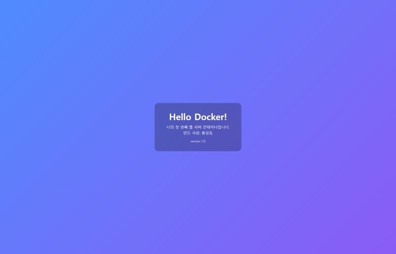

# 검증 로그 (실제 실행 결과)

이 문서의 모든 출력은 아래 환경에서 **직접 실행한 결과**를 옮긴 것입니다. 손으로 꾸며 쓴 예시가 아닙니다.

| 항목 | 값 |
|---|---|
| 검증일 | 2026-11-02 ~ 2026-11-03 (KST) |
| OS | Windows 11 Pro, build 26200 |
| 쉘 | Windows PowerShell 5.1 / cmd.exe (배치 파일) |
| Docker | `Docker version 29.9.2, build a82e528` (Docker Desktop 4.97.0) |
| Docker Compose | `v5.6.1` |
| 엔진 백엔드 | WSL2 · `Linux 6.18.54.1-microsoft-standard-WSL2` |
| 웹 서버 | nginx 1.31.8 (`nginx:latest`) |
| Git | `git version 2.54.0.windows.1` |

---

## 1. 설치 점검

```
$ docker --version
Docker version 29.9.2, build a82e528

$ docker compose version
Docker Compose version v5.6.1

$ git --version
git version 2.54.0.windows.1
```

```
$ docker info   (발췌)
Client:
 Version:    29.9.2
 Context:    desktop-linux
Server:
 Containers: 2
  Running: 2
 Images: 3
 Server Version: 29.9.2
 Storage Driver: overlayfs
 Kernel Version: 6.18.54.1-microsoft-standard-WSL2
 Operating System: Docker Desktop
 OSType: linux
 CPUs: 16
 Total Memory: 15.18GiB
 Name: docker-desktop
```

```
$ docker run --rm hello-world
Unable to find image 'hello-world:latest' locally
latest: Pulling from library/hello-world
4f55086f7dd0: Pull complete
Digest: sha256:c567b231f65614688711a75f31518a064258a51d442117a3e771a3a8fdba78ef
Status: Downloaded newer image for hello-world:latest

Hello from Docker!
This message shows that your installation appears to be working correctly.
```

## 2. 터미널·권한

```
$ whoami
desktop-1eet513\lovehjlee

$ icacls Dockerfile
Dockerfile BUILTIN\Administrators:(I)(F)
           NT AUTHORITY\SYSTEM:(I)(F)
           BUILTIN\Users:(I)(RX)
           NT AUTHORITY\Authenticated Users:(I)(M)
Successfully processed 1 files; Failed processing 0 files

$ Get-ExecutionPolicy
Bypass
```

읽는 법: `F`=모든 권한, `M`=수정, `RX`=읽기·실행, `(I)`=상위 폴더에서 상속.

## 3. 이미지 빌드

```
$ docker build -t my-web-server .
#1 [internal] load build definition from Dockerfile
#1 transferring dockerfile: 515B done
#2 [internal] load metadata for docker.io/library/nginx:latest
#4 [internal] load build context
#4 transferring context: 1.06kB done
#5 [1/2] FROM docker.io/library/nginx:latest@sha256:5ab5b0b01097...
#5 DONE 1.2s
#6 [2/2] COPY app/ /usr/share/nginx/html/
#6 DONE 0.2s
#7 exporting to image
#7 naming to docker.io/library/my-web-server:latest done
```

```
$ docker images
IMAGE                  ID             DISK USAGE   CONTENT SIZE   EXTRA
hello-world:latest     c567b231f656       25.9kB         9.49kB
my-web-server:latest   760997405362        241MB         63.9MB
nginx:latest           5ab5b0b01097        243MB         66.8MB   U
```

## 4. 포트 매핑

```
$ docker run -d -p 8081:80 --name my-site my-web-server
a30b0e4ea98aa565b7df5b7a3bca67691bcfce7dab153112bfd32bdda81d945f

$ docker ps
CONTAINER ID   IMAGE           STATUS         PORTS                                     NAMES
a30b0e4ea98a   my-web-server   Up 1 second    0.0.0.0:8081->80/tcp, [::]:8081->80/tcp   my-site
00b68ccfb62e   nginx           Up 3 seconds   0.0.0.0:8080->80/tcp, [::]:8080->80/tcp   my-final-web

$ curl.exe -s -i http://localhost:8081/
HTTP/1.1 200 OK
Server: nginx/1.31.8
Content-Type: text/html
Content-Length: 995
```

접속 화면: [docs/images/port-8081.jpg](images/port-8081.jpg)

## 5. 운영 명령

```
$ docker logs my-site   (발췌)
/docker-entrypoint.sh: Configuration complete; ready for start up
2026/11/02 16:06:48 [notice] 1#1: nginx/1.31.8
2026/11/02 16:06:48 [notice] 1#1: OS: Linux 6.18.54.1-microsoft-standard-WSL2
172.17.0.1 - - [02/Nov/2026:16:06:51 +0000] "GET / HTTP/1.1" 200 995 "-" "curl/8.21.0" "-"

$ docker stats --no-stream
CONTAINER ID   NAME           CPU %   MEM USAGE / LIMIT     MEM %   NET I/O           PIDS
a30b0e4ea98a   my-site        0.00%   15.13MiB / 15.18GiB   0.10%   1.46kB / 1.74kB   17
00b68ccfb62e   my-final-web   0.00%   13.98MiB / 15.18GiB   0.09%   1.38kB / 126B     17

$ docker inspect my-site --format "{{.State.Status}}"
running

$ docker exec my-site ls /usr/share/nginx/html
50x.html
index.html

$ docker stop my-site
my-site
$ docker ps -a --filter name=my-site
CONTAINER ID   IMAGE           STATUS                              NAMES
a30b0e4ea98a   my-web-server   Exited (0) Less than a second ago   my-site
$ docker start my-site
my-site
```

전체 로그: 배치 파일 `scripts/step07-operations.bat` 실행 시
`docs/docker-operations-log.txt` 로 자동 저장됩니다.

## 6. 바인드 마운트 (포트 8083)

```
$ docker run -d -p 8083:80 --name live-site \
    -v "C:\study\my-web-server\app:/usr/share/nginx/html" my-web-server
2ef3dfd58ee2321c7522bb40c601c62e57866b418771b243ea24294a47fe3ffd
```

호스트의 `app\index.html` 을 수정하고 **재빌드하지 않은 상태**에서 두 컨테이너를 비교한 결과:

```
[8083] 바인드 마운트  ->  <h1>안녕하세요, 도커!</h1>   version 2.0 (수정됨)   주황색
[8081] COPY 로 구움   ->  <h1>Hello Docker!</h1>     version 1.0           파란색
```

| 변경 전 | 변경 후 |
|---|---|
|  |  |

같은 이미지로 만든 컨테이너인데도 결과가 다릅니다. 8083은 호스트 폴더를 실시간으로 바라보고,
8081은 빌드 시점에 복사된 사본을 제공하기 때문입니다.

## 7. 볼륨 영속성 (포트 8082)

```
$ docker volume create my-volume
my-volume

$ docker run -d -p 8082:80 --name vol-test -v my-volume:/usr/share/nginx/html/data my-web-server
$ docker exec vol-test sh -c "echo hello-volume > /usr/share/nginx/html/data/memo.txt"
$ docker exec vol-test cat /usr/share/nginx/html/data/memo.txt
hello-volume
$ curl.exe -s http://localhost:8082/data/memo.txt
hello-volume
```

**컨테이너 삭제 후**

```
$ docker rm -f vol-test
vol-test
$ docker ps -a --filter name=vol-test
CONTAINER ID   IMAGE     COMMAND   CREATED   STATUS    PORTS     NAMES
          (비어 있음 = 컨테이너가 완전히 사라짐)

$ docker run -d -p 8082:80 --name vol-test2 -v my-volume:/usr/share/nginx/html/data my-web-server
dc1c904096744e81ee4c3a74ba7fe1814dc69862fd918184f1f00fcb5404eafa
$ docker exec vol-test2 cat /usr/share/nginx/html/data/memo.txt
hello-volume          <-- 컨테이너를 지웠는데도 데이터가 남아 있음
```

```
$ docker volume inspect my-volume
[
    {
        "CreatedAt": "2026-11-02T16:06:57Z",
        "Driver": "local",
        "Mountpoint": "/var/lib/docker/volumes/my-volume/_data",
        "Name": "my-volume",
        "Scope": "local"
    }
]
```

웹 확인: 

## 8. 의도적으로 재현한 에러

```
$ docker run -d -p 8080:80 --name conflict-test my-web-server
docker: Error response from daemon: failed to set up container networking:
driver failed programming external connectivity on endpoint conflict-test
(4dc7cf32b5494cda2d330889d69eedd4730dd95bda14073cfaf885d164b34818):
Bind for 0.0.0.0:8080 failed: port is already allocated
```

```
$ docker run -d -p 8099:80 --name my-site my-web-server
docker: Error response from daemon: Conflict. The container name "/my-site"
is already in use by container
"a30b0e4ea98aa565b7df5b7a3bca67691bcfce7dab153112bfd32bdda81d945f".
You have to remove (or rename) that container to be able to reuse that name.
```

```
$ curl.exe -s -o NUL -w "%{http_code}" http://localhost:8081/no-such-page.html
404
```

## 9. Git

```
$ git init
Initialized empty Git repository in C:/study/my-web-server/.git/

$ git status --short
?? .gitignore
?? Dockerfile
?? README.md
?? app/
?? docs/

$ git add . && git commit -m "feat: 첫 웹 서버 컨테이너 과제 제출"
[master (root-commit) e1578d6] feat: 첫 웹 서버 컨테이너 과제 제출
 6 files changed, 196 insertions(+)

$ git branch --show-current
master          <-- init.defaultBranch 를 설정하지 않아 master 로 생성됨

$ git branch -M main
$ git branch --show-current
main
```
