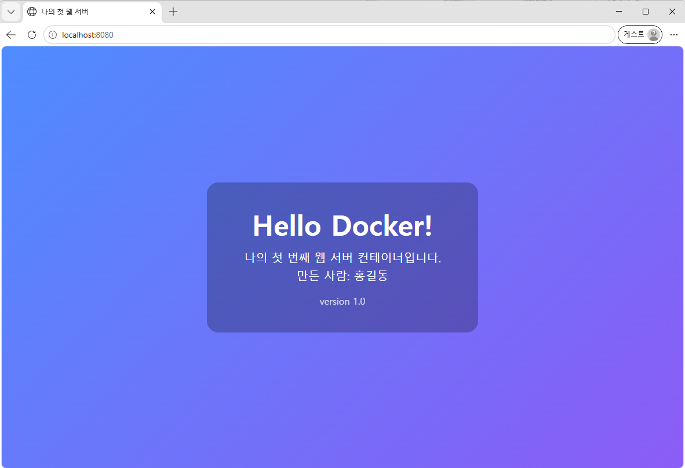
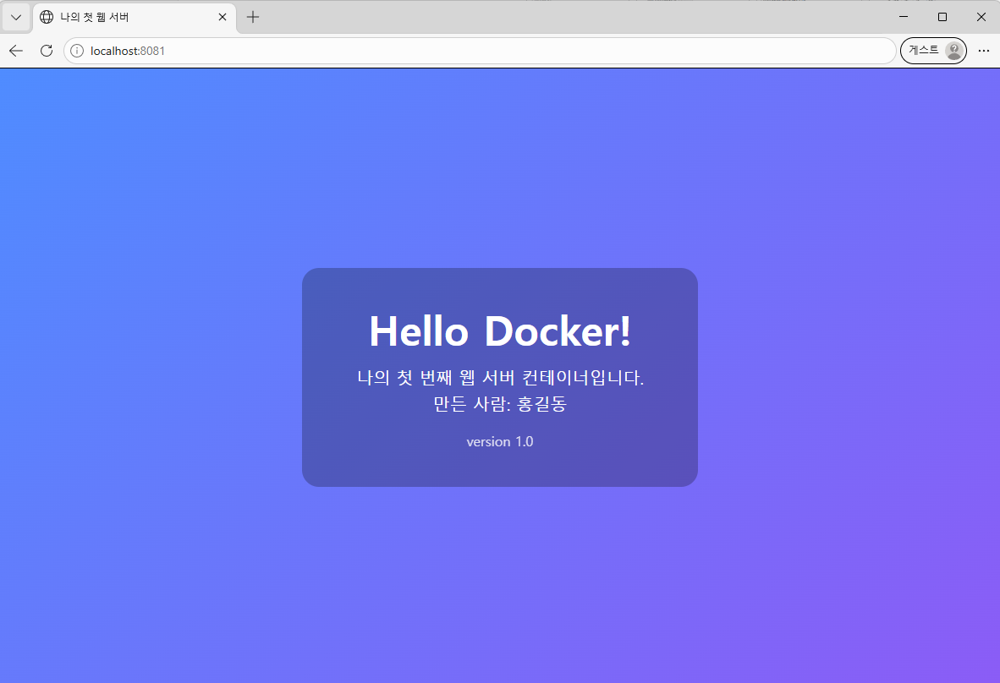

# 증거 08. 포트 매핑 및 접속 증거 (서로 다른 포트 2회)

`-p 호스트포트:컨테이너포트` 는 **내 컴퓨터의 포트**와 **컨테이너 안의 포트**를 잇는 통로입니다.
컨테이너는 자기만의 네트워크를 쓰기 때문에, 이 통로를 만들지 않으면 브라우저가 안으로 들어갈 수 없습니다.

왜 필요한가요? 컨테이너 안의 nginx 는 항상 **80번**을 씁니다. 그런데 내 컴퓨터에서 80번은 하나뿐이라
여러 개를 동시에 띄울 수 없습니다. 그래서 바깥쪽 번호만 8080, 8081 처럼 다르게 주는 것입니다.

### 접속 1 : 호스트 8080 → 컨테이너 80

```text
$ docker run -d -p 8080:80 --name web-8080 my-web-server:1.0
fd25db5631e2dfc661e67f29ab8612213161181b48447ddb85b17915b5cbec66
```

```text
$ curl -s -D - -o /dev/null http://localhost:8080/
HTTP/1.1 200 OK
Server: nginx/1.31.8
Date: Tue, 03 Nov 2026 14:01:00 GMT
Content-Type: text/html
Content-Length: 995
Last-Modified: Tue, 03 Nov 2026 11:28:19 GMT
Connection: keep-alive
ETag: "6ae9c553-3e3"
X-Mission: codyssey-m1
Accept-Ranges: bytes
```

### 접속 2 : 호스트 8081 → 컨테이너 80 (같은 이미지, 다른 포트)

```text
$ docker run -d -p 8081:80 --name web-8081 my-web-server:1.0
9521426a28333b123d06fd6ee6cd7bcbcd41fffdff0678c6f9f447cb086e46ca
```

```text
$ curl -s -D - -o /dev/null http://localhost:8081/
HTTP/1.1 200 OK
Server: nginx/1.31.8
Date: Tue, 03 Nov 2026 14:01:00 GMT
Content-Type: text/html
Content-Length: 995
Last-Modified: Tue, 03 Nov 2026 11:28:19 GMT
Connection: keep-alive
ETag: "6ae9c553-3e3"
X-Mission: codyssey-m1
Accept-Ranges: bytes
```

응답 헤더의 `X-Mission: codyssey-m1` 은 **내가 교체한 nginx 설정**이 적용됐다는 증거입니다.

```text
$ docker ps --filter name=web-80 --format "{{.Names}} / {{.Image}} / {{.Ports}}"
web-8081 / my-web-server:1.0 / 0.0.0.0:8081->80/tcp, [::]:8081->80/tcp
web-8080 / my-web-server:1.0 / 0.0.0.0:8080->80/tcp, [::]:8080->80/tcp
```

### 페이지 본문도 내가 만든 것인지 확인

```text
$ curl -s http://localhost:8080/ | grep -E "<h1>|ver"
    .ver { font-size: 16px; opacity: 0.8; margin-top: 20px; }
    <h1>Hello Docker!</h1>
    <p class="ver">version 1.0</p>
```

### 커스텀 환경 변수 확인

```text
$ docker exec web-8080 printenv APP_ENV
dev
```

### 없는 주소를 부르면 404

```text
$ curl -s -o /dev/null -w "%{http_code}\n" http://localhost:8080/no-such-page
404
```

### 브라우저 접속 화면 (주소창에 포트가 보입니다)





