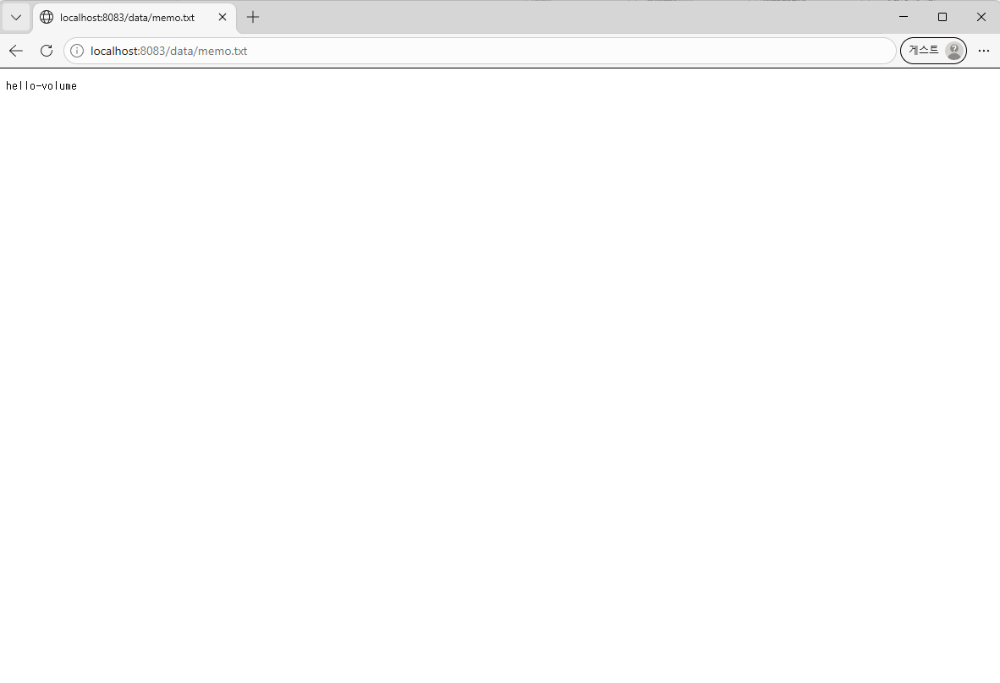
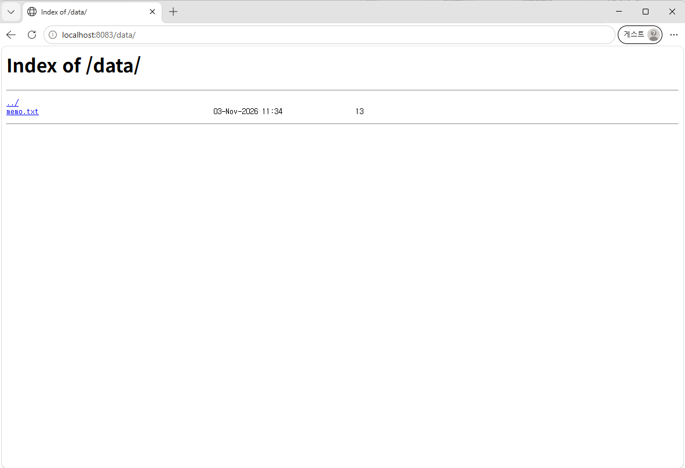

# 증거 10. Docker 볼륨 영속성 (컨테이너 삭제 전 / 후)

컨테이너는 **지우면 그 안의 내용도 같이 사라집니다.** 그래서 지켜야 할 데이터는
컨테이너 바깥의 **볼륨(보관함)** 에 넣습니다. 볼륨은 컨테이너를 지워도 남습니다.

```text
$ docker volume create my-data
my-data
```

```text
$ docker volume ls --filter name=my-data
DRIVER    VOLUME NAME
local     my-data
```

```text
$ docker run -d -p 8083:80 --name vol-8083 -v my-data:/usr/share/nginx/html/data my-web-server:1.0
57f838c04e6fd66f708a48e66719668f1530aa75c6506af07e60672a1b085e06
```

### ① 볼륨 안에 파일을 하나 만든다

```text
$ docker exec vol-8083 sh -c 'echo hello-volume > /usr/share/nginx/html/data/memo.txt'
```

```text
$ docker exec vol-8083 cat /usr/share/nginx/html/data/memo.txt
hello-volume
```

```text
$ curl -s http://localhost:8083/data/memo.txt
hello-volume
```

### ② 컨테이너를 통째로 삭제한다

```text
$ docker rm -f vol-8083
vol-8083
```

```text
$ docker ps -a --filter name=vol-8083
CONTAINER ID   IMAGE     COMMAND   CREATED   STATUS    PORTS     NAMES
```

목록이 비어 있습니다. 컨테이너는 완전히 사라졌습니다.

### ③ 그런데 볼륨은 남아 있다

```text
$ docker volume ls --filter name=my-data
DRIVER    VOLUME NAME
local     my-data
```

### ④ 새 컨테이너에 같은 볼륨을 붙이면 데이터가 그대로

```text
$ docker run -d -p 8083:80 --name vol-8083-new -v my-data:/usr/share/nginx/html/data my-web-server:1.0
029fbcf3df5fa1d82e1aaa61ed8e0514c474e3e2e8365e8df11c1f905a596a53
```

```text
$ docker exec vol-8083-new cat /usr/share/nginx/html/data/memo.txt
hello-volume
```

```text
$ curl -s http://localhost:8083/data/memo.txt
hello-volume
```

### ⑤ 볼륨이 실제로 저장되는 자리

```text
$ docker volume inspect my-data
[
    {
        "CreatedAt": "2026-11-03T14:01:02Z",
        "Driver": "local",
        "Labels": null,
        "Mountpoint": "/var/lib/docker/volumes/my-data/_data",
        "Name": "my-data",
        "Options": null,
        "Scope": "local"
    }
]
```

### ⑥ 브라우저 확인





