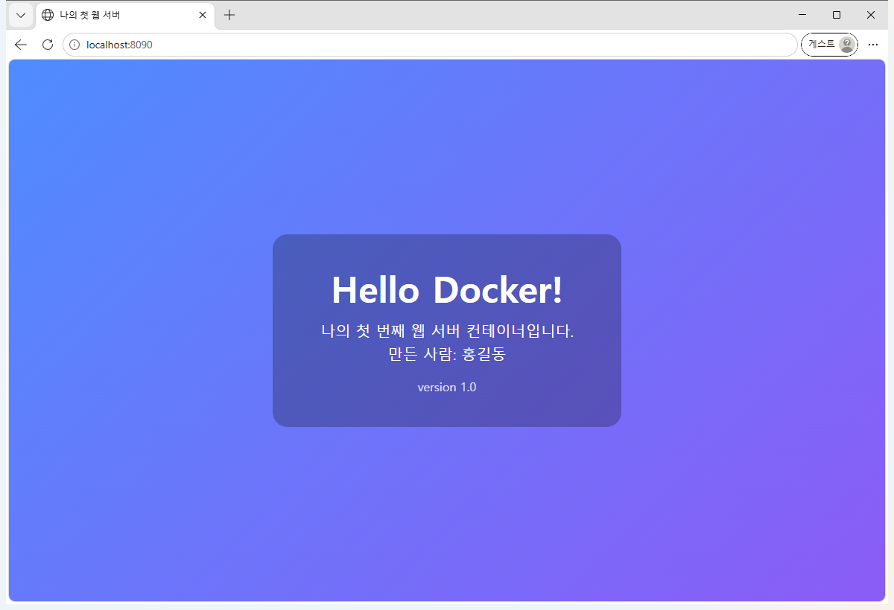
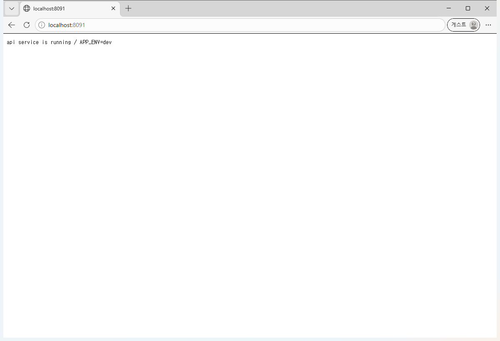

# 증거 12. 보너스 - Docker Compose (여러 컨테이너를 한 번에)

지금까지는 컨테이너를 `docker run` 으로 **하나씩** 띄웠습니다.
`docker-compose.yml` 에 설계도를 한 번 적어 두면 `docker compose up -d` 한 줄로 **전부** 켤 수 있습니다.

> 모든 명령은 **VS Code 의 bash(Git Bash) 터미널**에서 실행했고,
> 시작할 때 `export MSYS_NO_PATHCONV=1` 을 먼저 실행했습니다.

---

## ① Compose 기초 - 설계도 확인하고 띄우기

```text
$ docker compose version
Docker Compose version v5.6.1
```

```text
$ docker compose config --services
api
web
```

`.env` 파일은 깃허브에 올리지 않습니다. 예시 파일을 복사해서 만듭니다.

```text
$ cp .env.example .env && grep -v '^#' .env | grep -v '^$'
APP_ENV=dev
APP_MESSAGE=Hello Compose!
```

`docker compose config` 는 `.env` 값까지 **합친 최종 설계도**를 보여 줍니다.

```text
$ docker compose config | grep -E "APP_ENV|APP_MESSAGE|image:|8090|8091|container_name"
    container_name: compose-api
      APP_ENV: dev
    image: nginx:latest
        published: "8091"
    container_name: compose-web
      APP_ENV: dev
      APP_MESSAGE: Hello Compose!
    image: my-web-server:compose
        published: "8090"
```


## ② 멀티 컨테이너 - 한 줄로 2개를 동시에

```text
$ docker compose build
 Image my-web-server:compose Building 
#1 [internal] load local bake definitions
#1 reading from stdin 558B 0.0s done
#1 DONE 0.0s

#2 [internal] load build definition from Dockerfile
#2 transferring dockerfile: 790B done
#2 DONE 0.0s

#3 [internal] load metadata for docker.io/library/nginx:latest
#3 DONE 0.0s

#4 [internal] load .dockerignore
#4 transferring context: 135B done
#4 DONE 0.0s

#5 [internal] load build context
#5 transferring context: 1.13kB done
#5 DONE 0.0s

#6 [1/3] FROM docker.io/library/nginx:latest@sha256:5ab5b0b01097420873a3f3330f44248e34a3c2a3e8d5ee30658aeae8cb7435da
#6 resolve docker.io/library/nginx:latest@sha256:5ab5b0b01097420873a3f3330f44248e34a3c2a3e8d5ee30658aeae8cb7435da 0.0s done
#6 DONE 0.0s

#7 [2/3] COPY config/default.conf /etc/nginx/conf.d/default.conf
#7 CACHED

#8 [3/3] COPY app/ /usr/share/nginx/html/
#8 CACHED

#9 exporting to image
#9 exporting layers done
#9 exporting manifest sha256:c1932aaa82892debecb5efb7176193853e671c00df5a7edf433b83cdeb97df8e done
#9 exporting config sha256:b37e70cd629869745c23590560d115b00bde8d2abed105eaf2af61d168649dc8 done
#9 exporting attestation manifest sha256:9d5c09e6aa0c4017009b6486725388c764e2221e2b3d699a049042fec4c96e85 done
#9 exporting manifest list sha256:b0f7c2f39aee8b5ca97ac72336daa3a5d6ad24f86bbf0f5767a32dc17eb39e46 done
#9 naming to docker.io/library/my-web-server:compose done
#9 unpacking to docker.io/library/my-web-server:compose done
#9 DONE 0.0s

#10 resolving provenance for metadata file
#10 DONE 0.0s
 Image my-web-server:compose Built 
```

```text
$ docker compose up -d
 Network codyssey-bonus_default Creating 
 Network codyssey-bonus_default Creating 
 Network codyssey-bonus_default Created 
 Network codyssey-bonus_default Created 
 Container compose-api Creating 
 Container compose-api Created 
 Container compose-web Creating 
 Container compose-web Created 
 Container compose-api Starting 
 Container compose-api Started 
 Container compose-web Starting 
 Container compose-web Started 
```

```text
$ docker compose ps
NAME          IMAGE                   COMMAND                   SERVICE   CREATED        STATUS                  PORTS
compose-api   nginx:latest            "/docker-entrypoint.…"   api       1 second ago   Up Less than a second   0.0.0.0:8091->80/tcp, [::]:8091->80/tcp
compose-web   my-web-server:compose   "/docker-entrypoint.…"   web       1 second ago   Up Less than a second   0.0.0.0:8090->80/tcp, [::]:8090->80/tcp
```


두 서비스가 모두 `Up` 이고 포트가 **8090 / 8091** 로 나뉘어 있습니다.

### 컨테이너끼리 서비스 이름으로 서로를 찾는다

Compose 가 `codyssey-bonus_default` 라는 네트워크를 자동으로 만들어 주기 때문에,
IP 주소를 몰라도 **서비스 이름(`api`)** 으로 상대를 찾을 수 있습니다.

```text
$ docker network ls --filter name=codyssey-bonus
NETWORK ID     NAME                     DRIVER    SCOPE
5ea875f3b957   codyssey-bonus_default   bridge    local
```

```text
$ docker compose exec web getent hosts api
172.18.0.2      api
```

```text
$ docker compose exec api getent hosts web
172.18.0.3      web
```


## ③ 두 서비스 응답 확인 (브라우저로도 보입니다)

```text
$ curl -s http://localhost:8090/ | grep -E "<h1>|ver"
    .ver { font-size: 16px; opacity: 0.8; margin-top: 20px; }
    <h1>Hello Docker!</h1>
    <p class="ver">version 1.0</p>
```

```text
$ curl -s -D - -o /dev/null http://localhost:8090/
HTTP/1.1 200 OK
Server: nginx/1.31.8
Date: Tue, 03 Nov 2026 14:01:52 GMT
Content-Type: text/html
Content-Length: 995
Last-Modified: Tue, 03 Nov 2026 11:28:19 GMT
Connection: keep-alive
ETag: "6ae9c553-3e3"
X-Mission: codyssey-m1
Accept-Ranges: bytes
```

```text
$ curl -s http://localhost:8091/
api service is running / APP_ENV=dev
```

```text
$ curl -s -D - -o /dev/null http://localhost:8091/
HTTP/1.1 200 OK
Server: nginx/1.31.8
Date: Tue, 03 Nov 2026 14:01:52 GMT
Content-Type: text/plain
Content-Length: 36
Connection: keep-alive
X-Service: api
X-App-Env: dev
```


## ④ 환경 변수 활용

`docker-compose.yml` 에 `APP_ENV: ${APP_ENV:-dev}` 라고 적어 두었습니다.
"`.env` 에 값이 있으면 그 값을 쓰고, 없으면 `dev` 를 쓴다"는 뜻입니다.

```text
$ docker compose exec web printenv APP_ENV APP_MESSAGE
dev
Hello Compose!
```

```text
$ docker compose exec api printenv APP_ENV
dev
```


`.env` 의 값을 `stage` 로 바꾸고 다시 올리면 **응답까지 같이 바뀝니다.**

```text
$ sed -i 's/^APP_ENV=.*/APP_ENV=stage/' .env && grep '^APP_ENV' .env
APP_ENV=stage
```

```text
$ docker compose up -d
 Container compose-api Recreate 
 Container compose-api Recreated 
 Container compose-web Recreate 
 Container compose-web Recreated 
 Container compose-api Starting 
 Container compose-api Started 
 Container compose-web Starting 
 Container compose-web Started 
```

```text
$ docker compose exec api printenv APP_ENV
stage
```

```text
$ curl -s http://localhost:8091/
api service is running / APP_ENV=stage
```

다시 `dev` 로 되돌립니다.

```text
$ sed -i 's/^APP_ENV=.*/APP_ENV=dev/' .env && docker compose up -d
 Container compose-api Recreate 
 Container compose-api Recreated 
 Container compose-web Recreate 
 Container compose-web Recreated 
 Container compose-api Starting 
 Container compose-api Started 
 Container compose-web Starting 
 Container compose-web Started 
```

```text
$ docker compose exec api printenv APP_ENV
dev
```


## ⑤ Compose 운영 명령어

```text
$ docker compose logs --tail 3 api
compose-api  | 2026/11/03 14:01:56 [notice] 1#1: start worker process 48
compose-api  | 2026/11/03 14:01:56 [notice] 1#1: start worker process 49
compose-api  | 2026/11/03 14:01:56 [notice] 1#1: start worker process 50
```

```text
$ docker compose top web | head -n 4
SERVICE  #   UID    PID    PPID   C   STIME  TTY  TIME      CMD
web      1   root   18344  18319  1   14:01  ?    00:00:00  nginx: master process nginx -g daemon off;
web      1   statd  18396  18344  0   14:01  ?    00:00:00  nginx: worker process
web      1   statd  18397  18344  0   14:01  ?    00:00:00  nginx: worker process
```

```text
$ docker compose stop
 Container compose-web Stopping 
 Container compose-web Stopped 
 Container compose-api Stopping 
 Container compose-api Stopped 
```

```text
$ docker compose ps -a
NAME          IMAGE                   COMMAND                   SERVICE   CREATED         STATUS                              PORTS
compose-api   nginx:latest            "/docker-entrypoint.…"   api       5 seconds ago   Exited (0) Less than a second ago   
compose-web   my-web-server:compose   "/docker-entrypoint.…"   web       4 seconds ago   Exited (0) 1 second ago             
```

```text
$ docker compose start
 Container compose-api Starting 
 Container compose-api Started 
 Container compose-web Starting 
 Container compose-web Started 
```

```text
$ docker compose ps
NAME          IMAGE                   COMMAND                   SERVICE   CREATED         STATUS                  PORTS
compose-api   nginx:latest            "/docker-entrypoint.…"   api       6 seconds ago   Up Less than a second   0.0.0.0:8091->80/tcp, [::]:8091->80/tcp
compose-web   my-web-server:compose   "/docker-entrypoint.…"   web       5 seconds ago   Up Less than a second   0.0.0.0:8090->80/tcp, [::]:8090->80/tcp
```


## ⑥ down 해도 볼륨은 남는다

```text
$ docker compose exec web sh -c 'echo hello-compose-volume > /usr/share/nginx/html/data/memo.txt' ; docker compose exec web cat /usr/share/nginx/html/data/memo.txt
hello-compose-volume
```

```text
$ docker compose down
 Container compose-web Stopping 
 Container compose-web Stopped 
 Container compose-web Removing 
 Container compose-web Removed 
 Container compose-api Stopping 
 Container compose-api Stopped 
 Container compose-api Removing 
 Container compose-api Removed 
 Network codyssey-bonus_default Removing 
 Network codyssey-bonus_default Removed 
```

```text
$ docker compose ps -a
NAME      IMAGE     COMMAND   SERVICE   CREATED   STATUS    PORTS
```

```text
$ docker volume ls --filter name=codyssey-bonus
DRIVER    VOLUME NAME
local     codyssey-bonus_web-data
```

컨테이너와 네트워크는 사라졌지만 **볼륨은 남아 있습니다.** 다시 올려서 확인합니다.

```text
$ docker compose up -d
 Network codyssey-bonus_default Creating 
 Network codyssey-bonus_default Creating 
 Network codyssey-bonus_default Created 
 Network codyssey-bonus_default Created 
 Container compose-api Creating 
 Container compose-api Created 
 Container compose-web Creating 
 Container compose-web Created 
 Container compose-api Starting 
 Container compose-api Started 
 Container compose-web Starting 
 Container compose-web Started 
```

```text
$ docker compose exec web cat /usr/share/nginx/html/data/memo.txt
hello-compose-volume
```


> `docker compose down -v` 처럼 `-v` 를 붙이면 볼륨까지 지워집니다. 평소에는 붙이지 않습니다.

```text
$ docker compose ps --format "table {{.Service}}\t{{.Name}}\t{{.Status}}\t{{.Ports}}"
SERVICE   NAME          STATUS        PORTS
api       compose-api   Up 1 second   0.0.0.0:8091->80/tcp, [::]:8091->80/tcp
web       compose-web   Up 1 second   0.0.0.0:8090->80/tcp, [::]:8090->80/tcp
```


---

## ⑦ 브라우저 접속 증거 (주소창 + 응답 화면)

두 서비스가 **서로 다른 포트**로 동시에 떠 있습니다.
개인정보가 찍히지 않도록 **빈 임시 프로필(게스트 창)** 으로 열어 캡처했습니다.

### web 서비스 — `http://localhost:8090/`



### api 서비스 — `http://localhost:8091/`

환경 변수 `APP_ENV` 값이 그대로 화면에 나옵니다.


